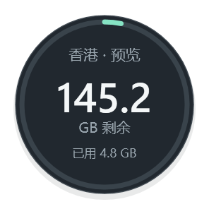
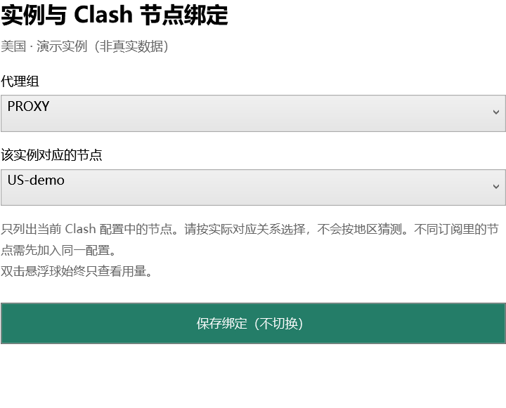

# 小鲸鱼流量悬浮球

一个干净、轻量交互的 Windows 桌面悬浮球。抬眼看剩余流量，右键查看本机流量分类，断网重连后继续工作。

基于 **.NET 8 / WPF**，使用 **MIT** 许可证开源。

> 当前套餐额度接口适配独角鲸云（Narwhal Cloud）；分类明细适配 Windows 上的 Clash Verge Rev / Mihomo。它是独立社区项目。



上图为演示数据，不包含真实账号、服务器或使用记录。

## 功能

- 圆球中央显示套餐**剩余 GB**，外圈显示本月已用比例。
- **双击**依次查看账号中的实例用量，始终不切换节点。
- **右键 → 切换实例（同时切节点）**：选择实例后切换其绑定的 Clash 节点；首次使用选择代理组和节点，后续直接切换。
- **右键 → 流量明细**：AI 工具、视频 / 直播、社交 / 通讯、云盘 / 文件、开发 / 更新、其他及未归类流量。
- 分类表显示上行、下行、合计和占比，可筛选今日 / 本月 / 累计、代理 / 直连及本机节点。
- **托盘常驻**，隐藏或关闭圆球后后台继续统计。双击托盘图标找回，选择“退出”才结束。
- 支持当前 Windows 用户的**开机自动启动**，右键可关闭。
- API Key 用 Windows DPAPI 加密保存在本机，重开自动读取；断网、切换代理和睡眠恢复会重试。
- 网络失败保留上次数据并显示未同步，不把请求失败当成用量归零。

## 下载和运行

打开 **[最新版本下载页](https://github.com/GUSHUCHUANGYI/little-whale-traffic-orb/releases/latest)**，下载 Windows x64 的 ZIP 文件，解压后运行 **小鲸鱼流量悬浮球.exe**。分享此下载页链接即可始终打开最新发布版本。

支持 Windows 10 / 11 x64。便携版自带 .NET 运行时，无需另装 .NET 或 WebView2。程序没有安装器，更新前从托盘菜单退出旧版本，再解压新版。

本项目没有代码签名证书，发行包提供 SHA-256 校验文件。请核对来源和校验值；不需要关闭安全软件或系统防护。

### 首次连接

1. 点击程序中的“打开官网”，在普通浏览器登录独角鲸云；支持使用官网提供的 Google 等登录方式。
2. 打开官网“个人资料 → API Key”，复制你自己的密钥并粘贴到程序，点击“连接并显示用量”。已有密钥无需重新生成。
3. 后续会自动读取保存在当前 Windows 用户下的加密凭据。更换 Key 时，右键选择“重新连接”。

**不要将 API Key、订阅链接或节点文件发到 Issue。** 服务商 API Key 可能具有完整账号 API 权限；本程序只调用查询接口，不购买、续费、删除或修改实例。

默认启用开机启动，写入当前用户的 `HKCU\Software\Microsoft\Windows\CurrentVersion\Run\TrafficOrb`。可从圆球或托盘右键取消“开机自动启动”。不安装系统服务，不要求管理员权限。

### 右键切换节点

1. 在 Clash 中运行含目标节点的配置，使用规则或全局模式。
2. 悬浮球右键 → **绑定 Clash 节点…** → 选择实例，指定它对应的代理组和节点后保存。绑定本身不切换网络；不按名称、地区或剩余流量猜测对应关系。
3. 右键 → **切换实例（同时切节点）** → 选择实例。程序先检查目标节点连通性，再修改这一代理组的选择并读回确认。首次直接使用切换菜单也会先打开绑定窗口。

只有明确点击右键切换或“绑定并切换”才会修改节点选择。双击圆球、查看用量、自动刷新、重连流量账号和重新启动程序均不切换节点。绑定保存在本机，重开后仍可用，可从绑定菜单修改。

目标节点必须在**当前 Clash 配置**中，程序不跨订阅切配置。如果美国、香港分属两份配置，先在 Clash 将两地节点放入同一配置。全局模式需绑定 `GLOBAL`，规则模式需绑定实际处理流量的手动代理组；自动测速组和 DIRECT 不作为实例节点提供。



目标连通检查失败、绑定失效或实例到期 / 停止时不执行切换。HTTP 写入后的确认超时会明确提示“核对当前节点”，不当作成功。节点切换对**新连接**生效，不强制关闭已有下载或会话，也不修改系统代理、TUN、网卡或路由。选择节点并不自动开启系统代理。

## 统计口径

| 数据 | 来源 | 范围 |
| --- | --- | --- |
| 套餐已用 / 剩余 | 服务商官方 HTTPS API，约 60 秒同步 | 整个实例，共享该实例的所有设备 |
| 类型、上行、下行及占比 | 本机 Mihomo `/connections` 只读接口，约每秒采样 | 程序运行期间，经这台电脑 Clash 的流量 |

套餐已用按平台口径为 **本月入站 + 本月出站**，GB 使用 1024³ 字节。平台统计本身可能延迟；套餐到期日不是流量重置日。

分类是按域名或应用名称推断的估计。轮询之间已关闭的短连接、无法确定类型或节点的流量保留为“未归类”，不强行分摊。分类不会补回运行前或其他电脑的使用记录，关闭程序时不记录。“全部连接”包含经 Clash 的直连流量；不经 Clash 的流量无法统计。

两组数据范围不同，**分类合计不能代替服务商账单**。程序仅在明确的右键切换操作中更新代理组选择，不会更换 Clash 配置、修改系统代理、启用控制端口或调整网卡和路由。

## 本地数据与隐私

兼容数据目录：`%LOCALAPPDATA%\TrafficOrb`。

| 文件 | 用途 |
| --- | --- |
| `account.dpapi` / `account.backup.dpapi` | 当前 Windows 用户加密的 API Key 及本机备份 |
| `settings.json` | 实例额度缓存、显示位置、选择项、节点绑定和启动偏好 |
| `traffic-history.json` | 每天每类、节点和字节合计 |

不保存网页正文、访问网址、目的 IP、应用路径或逐连接浏览记录；不上传分类数据。读取服务商响应时只保留额度所需字段，不缓存实例密码。

更新或移动程序时保留上述目录即可沿用凭据。DPAPI 数据不能直接复制到另一 Windows 用户或另一台电脑解密。卸载时先关闭开机启动并退出程序，再移除程序文件；需要清除本机记录时可自行移除该数据目录。

## 从源码构建

需要 Windows x64、[.NET 8 SDK](https://dotnet.microsoft.com/download/dotnet/8.0) 和 PowerShell。

```powershell
# 构建并运行自检，不需要服务商账号，不启动常驻或修改开机设置
.\scripts\Test.ps1

# 打包自带运行时的便携版和 SHA-256 校验文件
.\scripts\Publish.ps1 -Version 1.3.0
```

测试使用合成数据，覆盖流量计算、缺失字段、错误响应、网络重试、分类汇总、重启去重、域名边界、本地接口限制、节点切换前后验证以及凭据加密和恢复。测试不切换真实 Clash 节点。构建产物位于 `artifacts/`，不进入 Git。

## 项目结构

```text
src/TrafficOrb/     桌面程序、服务商读取、本机统计和自检
scripts/           Windows 测试与打包脚本
docs/images/       仅含合成数据的界面预览
.github/workflows/ Windows 构建验证
```

问题反馈请说明 Windows、Clash / Mihomo 和程序版本，以及复现步骤。提交截图前隐藏 API Key、账号信息和订阅凭据。

接口参考：[独角鲸云 OpenAPI](https://api.fuckip.me/openapi.yaml)、[Mihomo API](https://wiki.metacubex.one/en/api/)。

## 许可证

[MIT](LICENSE)。依赖说明见 [THIRD-PARTY-NOTICES.md](THIRD-PARTY-NOTICES.md)。
